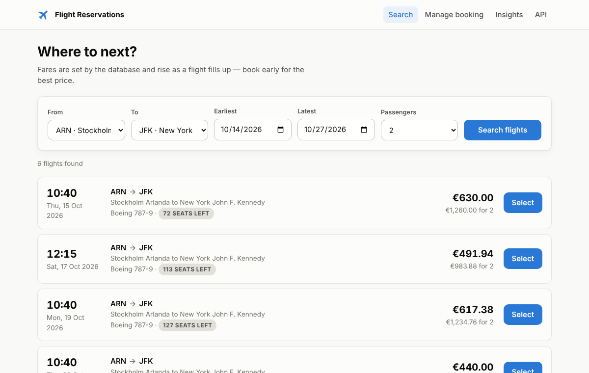
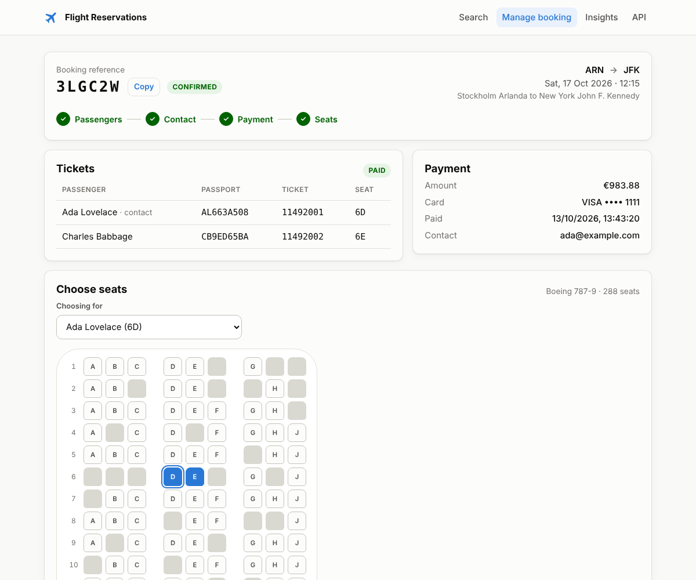
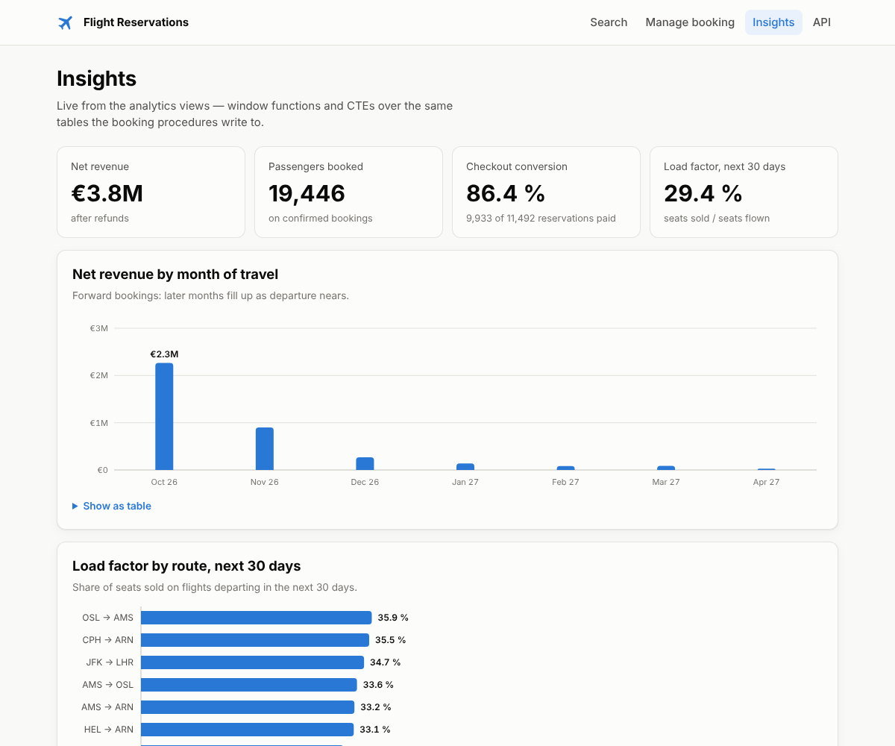
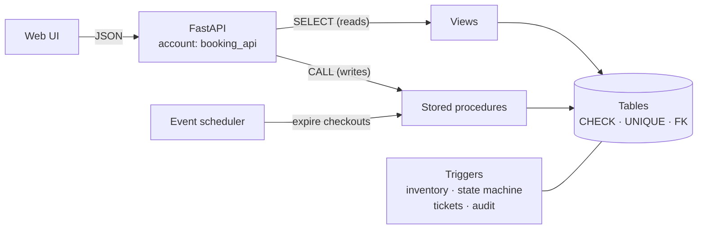
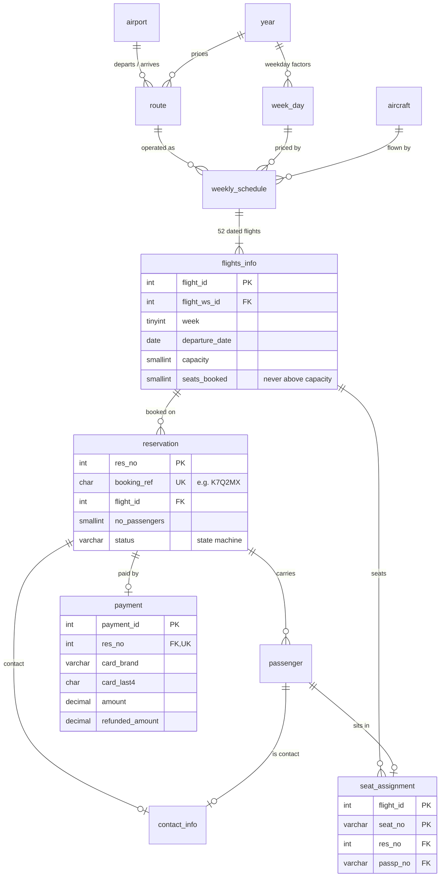
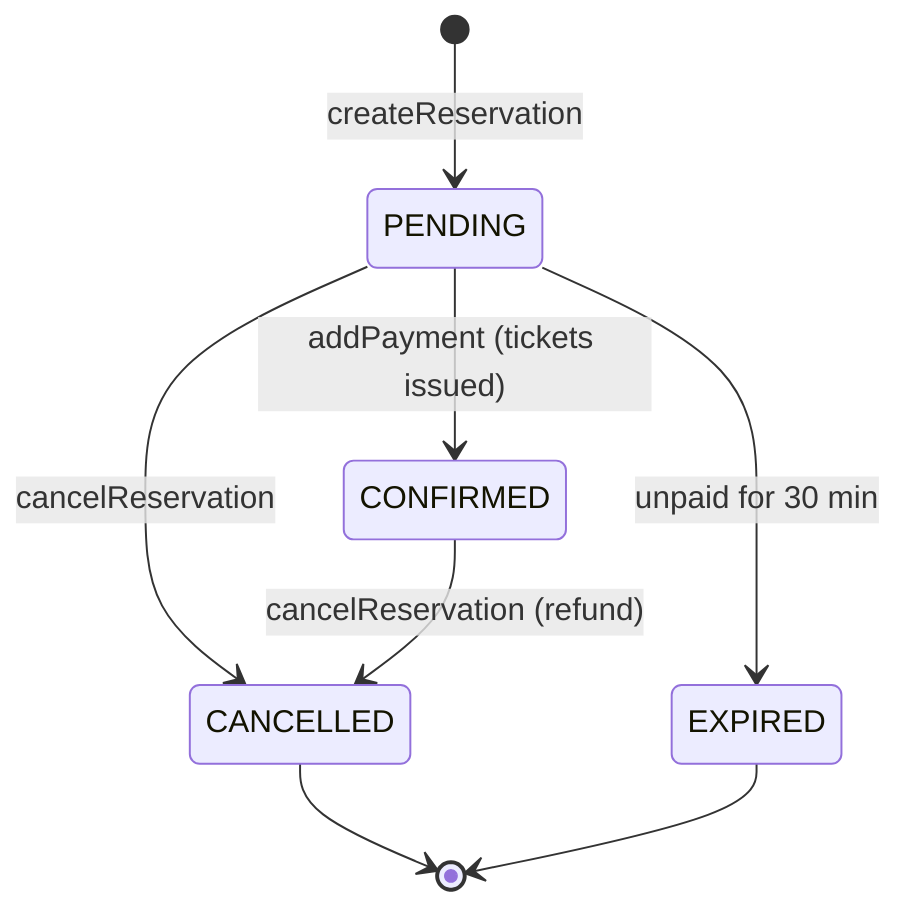

# Flight Reservation System

An airline booking system built database-first. **MySQL enforces every business rule itself:**
seat inventory that can't be oversold even under concurrent payments, demand-based pricing, a
guarded booking lifecycle, tokenised payments, seat maps, refunds and an audit trail. A FastAPI
service and a web UI sit on top with a least-privileged database account that cannot touch a
single table directly.

[](https://github.com/rjuzair/flight-reservation-database/actions/workflows/ci.yml)




<details>
<summary>More screenshots: booking with seat map, insights dashboard</summary>




</details>

## Highlights

- **Oversell-proof inventory.** Payments lock rows in a deliberate order and a
  `CHECK (seats_booked <= capacity)` constraint backs them up. A test fires eight payments at a
  four-seat aircraft at the same instant: exactly four succeed. (v1 of this schema sold 50 seats
  on a 40-seat flight under the same kind of race; [here's why](docs/architecture.md#concurrency-why-seats-cannot-be-oversold).)
- **The database guards its own invariants.** A trigger-enforced state machine
  (`PENDING → CONFIRMED → CANCELLED`, `PENDING → EXPIRED`), immutable payments, composite foreign
  keys and CHECK constraints hold whichever client issues the SQL.
- **Typed errors end to end.** Procedures `SIGNAL` application error numbers (`7101`
  insufficient seats, `7104` seat taken, …) that the API turns into RFC 9457 problem responses
  with the right HTTP status.
- **Least privilege.** The API's account holds one role, which grants `EXECUTE` on the booking
  procedures and `SELECT` on views and nothing else. Tests prove that `SELECT * FROM payment` is
  denied to it.
- **No card numbers at rest.** A Luhn check runs in SQL; only the brand and last four digits are
  stored, and the audit log never sees more.
- **Real airline features.** PNR-style booking references, aircraft seat maps (2-2, 3-3, 3-3-3),
  ISO-week flight dates, demand-based fares, tiered refunds and expiry of abandoned checkouts by
  the event scheduler.
- **Analytics in SQL.** Route league tables, revenue with running totals and month-on-month
  change, load factors and the checkout funnel, built from CTEs and window functions.
- **Tested on four engines.** 91 SQL assertions and 35 API integration tests run in CI on
  MySQL 8.0 and 8.4 and MariaDB 10.11 and 11.4, plus a Docker Compose smoke test.

## Quick start

You need Docker.

```bash
docker compose up --build --wait     # or: make up
```

On first start the database loads the schema and seeds about 11,000 bookings through the real
procedures (roughly 30 seconds). Then open:

| | |
|---|---|
| Web UI | http://localhost:8000 |
| Interactive API docs (OpenAPI) | http://localhost:8000/docs |
| MySQL | `localhost:3306`, user `root`, password `root` (see `.env.example`) |

Book a flight with the test card `4111 1111 1111 1111`. `make help` lists the other workflows
(`make test`, `make db-shell`, `make reset`, …).

### Just the database

```bash
mysql -e "CREATE DATABASE flight_reservations"
scripts/load-schema.sh mysql flight_reservations                  # modules 01–07
mysql -t flight_reservations < sql/demo_booking.sql               # guided tour of the rules
mysql flight_reservations < sql/seed_demo_data.sql                # optional: realistic data

mysql -e "CREATE DATABASE flight_tests"
scripts/load-schema.sh mysql flight_tests
mysql flight_tests < sql/tests.sql                                # 91 assertions
```

## Architecture



Writes go through stored procedures, which implement each use case and its rules. Reads go
through views. Triggers keep derived data (the seat inventory, tickets, the audit log) consistent
and reject illegal changes from any source. [docs/architecture.md](docs/architecture.md) covers
the design decisions, the concurrency analysis, the security model and the trade-offs.

## Data model



`audit_log` (not drawn) records every reservation, payment and seat change as JSON, with the
connected account. The original conceptual diagrams from v1 are in
[docs/er-diagram.pdf](docs/er-diagram.pdf) and [docs/relational-model.pdf](docs/relational-model.pdf).

### Booking lifecycle



Any other transition is rejected by `trg_reservation_status_guard`, even from a raw `UPDATE`.

## Business logic in the database

| Object | Kind | What it does |
|---|---|---|
| `createReservation` / `addReservation` | procedure | Reserves seats by flight id, or by route + week + weekday + time; returns a booking reference |
| `addPassenger`, `addContact` | procedures | Name passengers (size and duplicates checked under a row lock) and set or replace the contact |
| `addPayment` | procedure | Validates the card (Luhn), locks reservation then flight, re-checks seats, charges fare × passengers, confirms |
| `assignSeat`, `getSeatMap` | procedures | Seat selection against the aircraft's cabin layout; the seat map comes from a recursive CTE |
| `cancelReservation` | procedure | Refunds by policy, releases seats and seat assignments |
| `expirePendingReservations` | procedure + event | Expires abandoned checkouts every 5 minutes |
| `addYear`, `addDay`, `addDestination`, `addAircraft`, `addRoute`, `addFlight[WithAircraft]` | procedures | Reference data; a weekly departure creates 52 dated flights |
| `calculatePrice`, `calculateFreeSeats` | functions | `base × weekday × profit × (1 + sold / capacity)`; capacity − sold |
| `calculateRefund`, `refundPercentage` | functions | 100 % ≥ 30 days, 50 % ≥ 7 days, else 0 % |
| `isValidCardNumber`, `cardBrand`, `generateBookingRef`, `flightDate` | functions | Luhn check, card network, PNR generator, ISO-week dates |
| `ticketgenerator` | trigger | Issues unique ticket numbers on payment |
| `trg_reservation_inventory` | trigger | Keeps `seats_booked` in step with confirmed reservations |
| `trg_reservation_status_guard`, `trg_payment_guard` | triggers | State machine and immutability |
| audit triggers | triggers | Write `audit_log` for reservations, payments and seats |
| `v_flight_availability`, `allFlights`, `v_booking`, `v_booking_passengers` | views | Read models for search and booking pages |
| `v_route_performance`, `v_monthly_revenue`, `v_flight_load`, `v_booking_funnel` | views | Analytics with CTEs and window functions (`RANK`, running `SUM`, `LAG`) |
| `v_inventory_drift` | view | Operations check, expected to be empty |
| `flight_app`, `flight_analyst`, `flight_ops`, `flight_api` | roles | Least-privilege access |

## REST API

| Method | Path | Purpose |
|---|---|---|
| `GET` | `/api/flights?origin=ARN&destination=LHR&date_from=…&date_to=…&passengers=2` | Search bookable flights with current fares |
| `GET` | `/api/flights/{id}` · `/api/flights/{id}/seats` | Flight details · seat map |
| `GET` | `/api/airports` | Airports |
| `POST` | `/api/bookings` | Reserve seats → booking reference |
| `GET` | `/api/bookings/{ref}` | Booking with passengers, tickets, seats and payment |
| `POST` | `/api/bookings/{ref}/passengers` | Add a passenger |
| `PUT` | `/api/bookings/{ref}/contact` | Set the contact |
| `POST` | `/api/bookings/{ref}/payment` | Pay and issue tickets |
| `PUT` | `/api/bookings/{ref}/passengers/{passport}/seat` | Choose a seat |
| `GET` | `/api/bookings/{ref}/refund-quote` | Refund if cancelled now |
| `POST` | `/api/bookings/{ref}/cancel` | Cancel and refund |
| `GET` | `/api/insights/summary` · `/routes` · `/monthly-revenue` · `/upcoming-load` | Analytics (optionally behind `X-API-Key`) |
| `GET` | `/api/health` | Liveness and database version |

Errors are [RFC 9457](https://www.rfc-editor.org/rfc/rfc9457) problem documents:

```json
{"type": "about:blank", "title": "Conflict", "status": 409,
 "error": "SEAT_TAKEN", "detail": "The seat is already taken", "code": 7104}
```

The full error catalogue is in [docs/architecture.md](docs/architecture.md#error-catalogue).

## Testing

| Suite | Size | Highlights |
|---|---|---|
| [`sql/tests.sql`](sql/tests.sql) | 91 assertions | Every rule and the exact error number of each rejection; dated relative to today, so it never goes stale |
| [`api/tests`](api/tests) | 35 tests | Full workflow over HTTP, concurrent-payment and same-seat races, privilege checks for the API account |
| Seed check | ~11k bookings | Generated through the procedures, then `v_inventory_drift` must be empty |
| Compose smoke test | whole stack | Boots from an empty volume, then exercises the API and the UI |

```bash
make up && make test          # SQL + API suites against the running stack
```

CI runs the SQL suites on MySQL 8.0, MySQL 8.4, MariaDB 10.11 and MariaDB 11.4, and the API
suite on MySQL 8.4 and MariaDB 11.4.

## Performance

On the seeded database (7,696 flights), listing free seats and the current fare for every flight
takes **~15 ms** with the inventory counter and set-based view, against **~600 ms** for v1's
per-row stored functions, with identical results. Searches run as a single merged plan over
unique indexes; see [Performance](docs/architecture.md#performance).

## Project structure

```
sql/
  01_schema.sql … 07_security.sql   database modules, loaded in order
  tests.sql                         assertions
  demo_booking.sql                  guided tour
  seed_demo_data.sql                realistic data via the procedures
api/
  app/                              FastAPI service (routers, repository, error mapping, pool)
  app/static/                       web UI
  tests/                            integration tests
docker/initdb.sh                    first-start initialisation for the MySQL container
scripts/                            load-schema.sh, create-api-user.sh
docs/                               architecture.md, screenshots, v1 diagrams
docker-compose.yml · Makefile · .github/workflows/ci.yml
```

## What changed from v1

v1 was a single `schema.sql` file. v2 keeps its procedure names and its booking workflow and
adds:

- **A fix for a real oversell race** in `addPayment`, with a regression test.
- **Hardened types and constraints**: DECIMAL money, utf8mb4, CHECKs, NOT NULLs, natural keys,
  indexes.
- **New features**: aircraft and seat maps, real flight dates, booking references, the
  cancellation and refund policy, checkout expiry, the audit trail and analytics.
- **Typed `SIGNAL` errors** instead of `SELECT 'message'`.
- **A bounded, demand-based fare.** The old formula, `(booked + 1) / 40`, priced the first seat
  of a large aircraft at almost nothing.
- **The application layer**: a least-privileged API, a web UI, Docker Compose and CI on four
  database engines.
