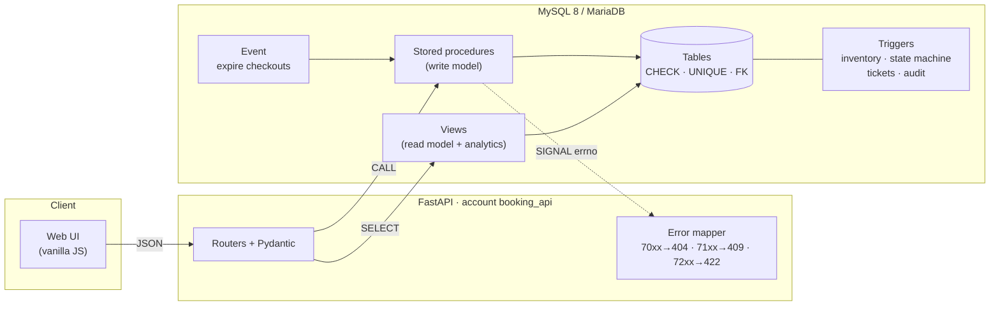
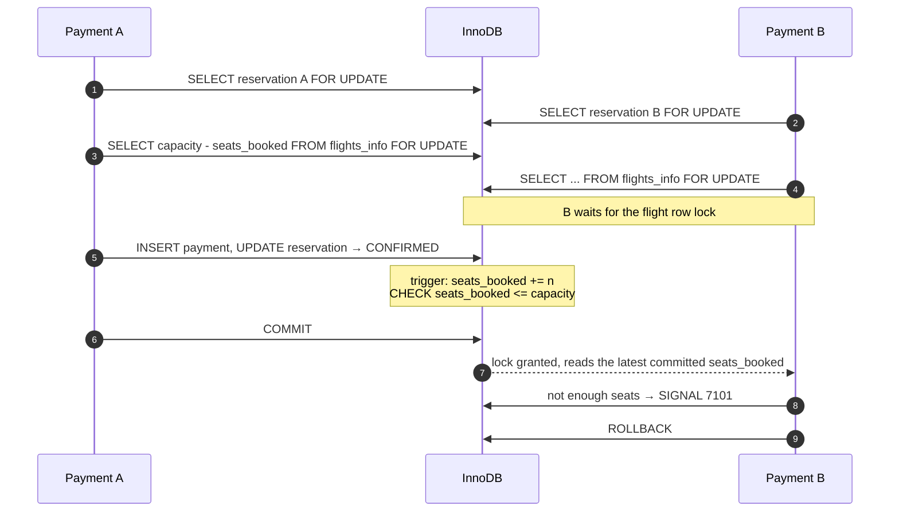
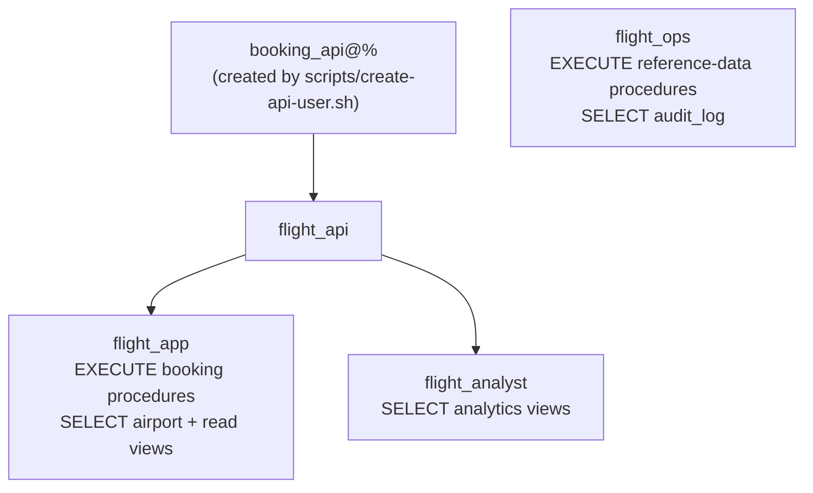

# Architecture and design decisions

This document explains *why* the system is built the way it is. The
[README](../README.md) covers what it does and how to run it.

- [Principles](#principles)
- [Layers](#layers)
- [Concurrency: why seats cannot be oversold](#concurrency-why-seats-cannot-be-oversold)
- [Integrity enforced by the database](#integrity-enforced-by-the-database)
- [Pricing and refunds](#pricing-and-refunds)
- [Security model](#security-model)
- [Error catalogue](#error-catalogue)
- [Performance](#performance)
- [Testing strategy](#testing-strategy)
- [Trade-offs and what a production system would add](#trade-offs-and-what-a-production-system-would-add)

## Principles

1. **The database is the source of truth for business rules.** Seat inventory,
   pricing, the booking lifecycle, payments and refunds are enforced by
   constraints, triggers and stored procedures. Any client (the API, a
   batch job, a DBA at a SQL prompt) gets the same guarantees.
2. **Defence in depth.** Each important invariant is protected twice: once by
   the procedure that implements the use case (for a clear error), and once by
   a declarative constraint or trigger (so no code path can break it).
3. **Writes through procedures, reads through views.** The application account
   holds no privileges on base tables at all.
4. **Fail loudly and precisely.** Every rejection is a `SIGNAL` with an
   application error number that maps to an HTTP status, never a result set
   with a message that a caller might ignore.

## Layers



| Layer | Location | Responsibility |
|---|---|---|
| Schema | `sql/01_schema.sql` | Tables, keys, CHECK constraints, indexes |
| Functions | `sql/02_functions.sql` | Calendar, inventory, pricing, Luhn check, booking references, refund policy |
| Procedures | `sql/03_procedures.sql` | Reference data and every booking use case |
| Triggers | `sql/04_triggers.sql` | Inventory counter, state machine, immutability, tickets, audit log |
| Views | `sql/05_views.sql` | Read models for the API, analytics for reporting |
| Jobs | `sql/06_jobs.sql` | Scheduled expiry of abandoned checkouts |
| Security | `sql/07_security.sql` | Roles and grants |
| API | `api/app/` | HTTP, validation, error translation, connection pooling |
| UI | `api/app/static/` | A thin client over the API |

Every SQL module is idempotent (`DROP ... IF EXISTS` then `CREATE`), so
`scripts/load-schema.sh` rebuilds the database from scratch.

## Concurrency: why seats cannot be oversold

### The bug in v1

v1's `addPayment` locked the flight row with `SELECT ... FOR UPDATE`, which
looks correct. It first read the reservation with a plain `SELECT`, though.
Under InnoDB's default REPEATABLE READ isolation, **a transaction's snapshot
is fixed at its first plain (non-locking) read**. So a second payment would
wait for the lock and then count free seats from a snapshot taken *before*
the first payment committed. Both payments saw the same free seats and both
succeeded.

Ten concurrent payments of five passengers each, against a 40-seat flight,
sold **50 seats, every time**.

### The fix: three layers



1. **Lock before reading.** `addPayment` locks the reservation row (so it
   cannot be paid twice) and then the flight row, *before any plain read*.
   Payments for the same flight run one at a time, and the locking read
   returns the latest committed inventory. The lock order is always
   reservation, then flight (cancellation uses the same order), so payments
   and cancellations cannot deadlock each other.
2. **An inventory counter guarded by a constraint.** `flights_info.seats_booked`
   holds the passengers on CONFIRMED reservations. It is maintained by the
   `trg_reservation_inventory` trigger whenever a reservation's status changes,
   and `CHECK (seats_booked <= capacity)` makes overselling impossible, even
   for a hand-written `UPDATE reservation SET status = 'CONFIRMED'`.
3. **The primary key is the guard for seats.** `seat_assignment` has the key
   `(flight_id, seat_no)`, so two passengers can never hold the same seat; the
   duplicate-key error is turned into `7104 SEAT_TAKEN`.

`v_inventory_drift` lists any flight whose counter disagrees with its
reservations. The tests and CI assert that it stays empty, including after
the 11k-reservation seed.

The regression tests (`api/tests/test_concurrency.py`) release eight payments
at once through a barrier against a four-seat aircraft: exactly four succeed
and four get `7101`. With the `FOR UPDATE` locks removed, the same test fails
with deadlocks and wrong outcomes, so the test really guards the fix.

### Why pending reservations hold no seats

A reservation takes seats only when it is paid. That keeps abandoned
checkouts from blocking inventory, at the cost of re-checking availability at
payment time, which the locking above makes safe. Abandoned checkouts are
expired after 30 minutes by `ev_expire_pending_reservations`.

## Integrity enforced by the database

| Invariant | Enforced by |
|---|---|
| A flight never has more passengers than seats | `chk_flight_inventory` + trigger + locked check in `addPayment` |
| A seat is held by at most one passenger | `PRIMARY KEY (flight_id, seat_no)` |
| Reservations follow PENDING → CONFIRMED → CANCELLED / PENDING → EXPIRED | `trg_reservation_status_guard` (`7109`) |
| A reservation's flight, size and reference never change | `trg_reservation_status_guard` (`7110`) |
| A captured payment amount never changes; refunds only grow | `trg_payment_guard` (`7111`) |
| Refund ≤ amount paid | `chk_payment_refund` |
| One payment and one contact per reservation | `UNIQUE (res_no)` / `PRIMARY KEY (res_no)` |
| The contact is one of the reservation's passengers | composite foreign key `(res_no, passp_no)` |
| A passenger is ticketed on a flight at most once | `addPassenger` (`7107`) |
| All passengers are named and a contact exists before payment | `addPayment` (`7202`, `7201`) |
| Valid codes, prices, factors, weekdays, e-mails, phones | `CHECK` constraints |
| Every booking state change is recorded | audit triggers on `reservation`, `payment`, `seat_assignment` |

## Pricing and refunds

**Fare per seat** (`calculatePrice`):

```
base fare × weekday factor × yearly profit factor × (1 + seats sold / capacity)
```

An empty flight sells at the base price and the last seat at twice that, so
the fare rises with demand but stays within a predictable band. v1 used
`(booked + 1) / 40`, which on a large aircraft made the first seat cost about
1/180th of the base fare. The payment charges the fare at the moment of
payment for every passenger, computed under the flight lock.

`v_flight_availability` applies the same formula to every flight in a single
set-based query. The test suite asserts that the view and `calculatePrice`
agree on every flight.

**Refund policy** (`refundPercentage`, `calculateRefund`):

| Time to departure | Refund |
|---|---|
| 30 days or more | 100 % |
| 7–29 days | 50 % |
| under 7 days | 0 % |
| after departure | cancellation rejected (`7108`) |

The functions take an explicit "as of" time, so every tier is tested
deterministically. `cancelReservation` applies them with `NOW()`.

## Security model



- **Least privilege.** The API's account has no table privileges. Procedures
  and views are `SQL SECURITY DEFINER`, so it can use them without seeing the
  tables underneath. `api/tests/test_security.py` proves that `SELECT * FROM
  payment`, `UPDATE flights_info` and `CALL addYear` are all denied to it.
- **No secrets in the repository.** Passwords come from the environment
  (`.env`, CI secrets). Roles are created in SQL; accounts by a script.
- **Card data.** The database never stores a card number: the Luhn check runs
  on the way in, and only the brand and last four digits are kept. The audit
  log only sees those too, and a test asserts the number appears nowhere. The
  API takes the number as a `SecretStr`, so it stays out of logs and error
  messages. A production system would go further and never let the number
  reach its servers at all; see the trade-offs below.
- **Enumeration-resistant identifiers.** Clients address bookings by a random
  six-character reference (`K7Q2MX`), drawn from an alphabet without the
  look-alikes 0/O and 1/I. Sequential reservation numbers never leave the API.
- **Accountability.** Audit rows record `USER()`, the connected account, not
  `CURRENT_USER()`, which inside a definer-rights procedure would be the definer.
- **Web.** The UI builds the DOM with text nodes only (no `innerHTML` with
  data). Responses carry `X-Content-Type-Options: nosniff` and a request ID.
  Analytics can be put behind an API key (`INSIGHTS_API_KEY`).

## Error catalogue

Procedures raise `SQLSTATE 45000` with these error numbers. The API returns
them as [RFC 9457](https://www.rfc-editor.org/rfc/rfc9457) problem documents:

```json
{"type": "about:blank", "title": "Conflict", "status": 409,
 "error": "INSUFFICIENT_SEATS", "detail": "The flight is fully booked, payment declined", "code": 7101}
```

| Code | Name | HTTP | Meaning |
|---|---|---|---|
| 7001 | `FLIGHT_NOT_FOUND` | 404 | No such flight |
| 7002 | `BOOKING_NOT_FOUND` | 404 | No such reservation |
| 7003 | `PASSENGER_NOT_ON_BOOKING` | 404 | The passport is not on this reservation |
| 7004 | `ROUTE_NOT_FOUND` | 404 | No route for these airports and year |
| 7005 | `AIRCRAFT_NOT_FOUND` | 404 | Unknown aircraft type |
| 7101 | `INSUFFICIENT_SEATS` | 409 | Not enough free seats |
| 7102 | `ALREADY_PAID` | 409 | The reservation is already paid |
| 7103 | `BOOKING_NOT_ACTIVE` | 409 | The reservation is cancelled or expired |
| 7104 | `SEAT_TAKEN` | 409 | Someone else has that seat |
| 7105 | `PASSENGER_LIST_FULL` | 409 | All passengers are already named |
| 7106 | `DUPLICATE_PASSENGER` | 409 | The passport is already on this reservation |
| 7107 | `PASSENGER_ALREADY_TICKETED` | 409 | The passenger already has a ticket on this flight |
| 7108 | `FLIGHT_DEPARTED` | 409 | The flight has already left |
| 7109 | `ILLEGAL_STATUS_TRANSITION` | 409 | Not a legal booking state change |
| 7110 | `BOOKING_IMMUTABLE` | 409 | Flight, size and reference are fixed |
| 7111 | `PAYMENT_IMMUTABLE` | 409 | Captured amounts cannot change |
| 7201 | `CONTACT_REQUIRED` | 422 | Add a contact before paying |
| 7202 | `PASSENGERS_INCOMPLETE` | 422 | Name every passenger before paying |
| 7203 | `INVALID_CARD` | 422 | The card number fails the Luhn check |
| 7204 | `INVALID_SEAT` | 422 | No such seat on this aircraft |
| 7205 | `BOOKING_NOT_PAID` | 422 | Seats are chosen after payment |
| 7206 | `INVALID_PASSENGER_COUNT` | 422 | A reservation needs at least one passenger |
| 1062 | `DUPLICATE` | 409 | Unique key violation |
| 3819 / 4025 | `CONSTRAINT_VIOLATION` | 422 | CHECK constraint (MySQL / MariaDB) |
| 1205 / 1213 | `TRY_AGAIN` | 503 | Lock wait timeout or deadlock; safe to retry (`Retry-After: 1`) |

## Performance

Measured on the seeded database (7,696 flights, ~11.5k reservations), MySQL
8.4 in Docker:

| Query: free seats and fare for every flight | Time |
|---|---|
| v1 approach: stored functions that aggregate reservations per row | ~600 ms |
| v2: `v_flight_availability` over the inventory counter | ~15 ms |

Both return identical totals. The v2 view joins only (no aggregation), so the
optimizer merges it into the caller's query. A search such as "departures from
ARN in the next 14 days" runs as a single `SIMPLE` plan that starts from the
airport and walks `uq_route` → `uq_schedule` → `uq_flight`, without a full
scan of any large table.

Other choices that matter at scale:

- `idx_reservation_flight (flight_id, status)` serves per-flight lookups;
  `idx_reservation_status_created (status, created_at)` serves the expiry job.
- The API pools connections and runs in autocommit mode: procedures own their
  transactions, so no request holds a transaction open across a network hop.
- The seed relaxes `innodb_flush_log_at_trx_commit` and `sync_binlog` only for
  the duration of the bulk load, then restores them.

## Testing strategy

| Suite | What it proves | Runs on |
|---|---|---|
| `sql/tests.sql` | 91 assertions on every rule, including the exact error number of each rejection; fixtures are dated relative to today so the suite never goes stale | MySQL 8.0, 8.4, MariaDB 10.11, 11.4 |
| `sql/demo_booking.sql` | The guided tour runs end to end | same |
| `sql/seed_demo_data.sql` | ~11k bookings through the real procedures leave zero inventory drift | same |
| `api/tests` | 35 HTTP and integration tests against a real server: workflow, problem responses, races, privileges | MySQL 8.4, MariaDB 11.4 |
| Compose smoke test | The full stack boots from an empty volume and serves the API and the UI | MySQL 8.4 |

The suites were mutation-tested while they were written: removing the
`FOR UPDATE` locks, the inventory CHECK or the duplicate-passenger check, or
moving a refund boundary by one day, each makes a specific test fail.

## Trade-offs and what a production system would add

- **Logic in the database** gives one enforcement point for every client and
  makes invariants provable, at the cost of portability. The SQL targets
  MySQL 8 and MariaDB 10.11+, and CI runs on both.
- **Weekly schedules materialise 52 dated flights.** That is simple and
  index-friendly. A real airline would also model schedule changes, aircraft
  swaps, time zones and multi-leg itineraries.
- **Payments.** In production the browser would send the card to a payment
  provider (Stripe, Adyen) and the API would only see a token. The Luhn check
  and last-4 storage show the data-minimisation principle without a third party.
- **Authentication.** A booking reference is the only credential for managing
  a booking. Real airlines add the passenger's surname or a signed link.
- **Migrations.** Modules are rebuilt idempotently, which suits a portfolio
  project. A production database would apply versioned migrations
  (Flyway, Liquibase or Atlas) to preserve data.
- **Overbooking and waitlists** are deliberately absent: the CHECK constraint
  makes capacity a hard limit.
